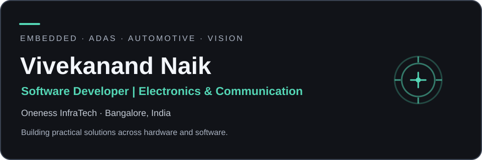
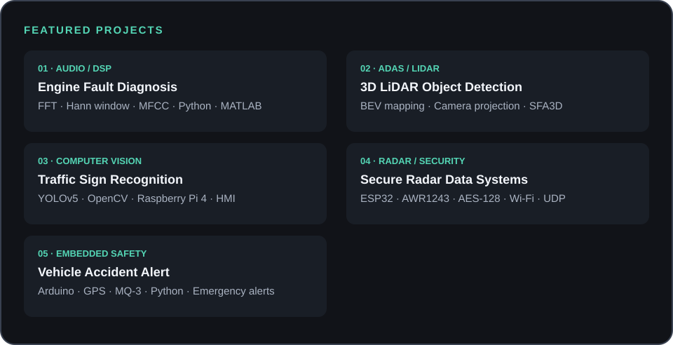

  

## 👋 About Me

I’m an **Electronics & Communication Engineering graduate** from **KLE Technological University**, currently working as a **Software Developer at Oneness InfraTech**.

I enjoy building software solutions and exploring the intersection of **hardware and software**—with a particular focus on **Embedded Systems, ADAS, Automotive Software, Computer Vision and Signal Processing**.

> My work reflects a passion for practical engineering, continuous learning and solving real-world problems.

 

## 🧰 Technical Expertise

<table>
  <tr>
    <td width="50%" valign="top"></td>
    <td width="50%" valign="top">

### Core Skills

- **Languages:** C, C++, Python
- **Computer Vision:** OpenCV, YOLOv5, MediaPipe
- **Embedded:** Arduino, Raspberry Pi, Linux
- **Signal Processing:** MATLAB, NumPy, FFT, MFCC
- **Workflow:** VS Code, Git, GitHub, Google Colab

### Focus Areas

`ADAS` `Embedded C/C++` `Automotive Software` `Sensor Fusion` `Computer Vision` `DSP` `Real-Time Systems`

</td>
  </tr>
</table>

 

## 🚀 Featured Projects

  

| Project | Description | Technology |
|:--|:--|:--|
| [Engine Fault Diagnosis](https://github.com/vivekanandnaikk/Engine-Fault-Diagnosis-Using-Audio-Signal-Processing) | DSP-based comparison of normal and faulty motorcycle engine recordings using FFT, Hann windowing and MFCC extraction. | Python · MATLAB · NumPy · DSP |
| [Real-Time 3D LiDAR Detection](https://github.com/vivekanandnaikk/Real-Time-3D-LiDAR-Based-Object-Detection) | LiDAR-based 3D object detection for ADAS, including BEV mapping and camera-image projection. | Python · LiDAR · Computer Vision · SFA3D |
| [Traffic Sign Recognition](https://github.com/vivekanandnaikk/Traffic-Sign-Recognition-System) | Real-time traffic sign detection and recognition with Raspberry Pi deployment and HMI integration. | Python · YOLOv5 · OpenCV · Raspberry Pi 4 |
| [Secure Radar Data Systems](https://github.com/vivekanandnaikk/Pioneering-Secure-Radar-Data-Systems) | Radar distance measurement with encrypted wireless data communication. | ESP32 · Radar · AES-128 · Wi-Fi · UDP |
| [Vehicle Accident Alert](https://github.com/vivekanandnaikk/Vehicle-Accident-Alert-System) | Automotive safety prototype for vibration, alcohol, GPS and emergency notifications. | Arduino Uno · Python · GPS · MQ-3 |

 

## 🔭 Currently Exploring

- Advanced Driver Assistance Systems (ADAS)
- Embedded C/C++ and firmware development
- Automotive software and Software Defined Vehicles
- Sensor fusion and perception systems
- Computer vision and real-time applications

 

### 🤝 Let’s Connect

 

*Building. Experimenting. Learning. Growing.*

