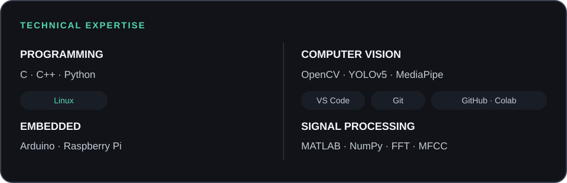

  

  <a href="https://www.linkedin.com/in/vivekanand-naik">LinkedIn</a> ·
  <a href="https://bio.site/vivekanandnaik">Portfolio</a> ·
  <a href="https://github.com/vivekanandnaikk">GitHub</a>

I’m an Electronics & Communication Engineering graduate from **KLE Technological University**, currently working as a **Software Developer at Oneness InfraTech**. I enjoy building practical software solutions and exploring the intersection of hardware and software.

### About me

- 🚗 Interested in embedded systems, ADAS, automotive software, and Software Defined Vehicles.
- 🤖 Exploring computer vision, sensor fusion, object detection, and machine learning.
- 🔊 Interested in signal processing, audio analysis, and DSP applications.
- 🌱 Focused on practical engineering, problem-solving, and continuous learning.

### Areas of interest

Embedded systems · ADAS · Automotive software · Computer vision · Sensor fusion · Signal processing · DSP · Artificial intelligence · Real-time applications

### Featured projects

### Currently exploring

Advanced Driver Assistance Systems (ADAS) · Embedded C/C++ and firmware development · Automotive software and Software Defined Vehicles · Sensor fusion and perception systems · Computer vision and real-time applications

---

⭐ *Building. Experimenting. Learning. Growing.*
